# Linux Server Lab

A hands-on lab where I built and administered an Ubuntu Server inside a VirtualBox virtual machine, practicing core Linux system administration, networking, security hardening and Bash scripting.

## Environment

| Item | Details |
|------|---------|
| Host | Windows 11, Lenovo IdeaPad 3 (Intel Core i3, 12 GB RAM) |
| Hypervisor | Oracle VirtualBox |
| Guest OS | Ubuntu Server 26.04 LTS (no GUI) |
| VM resources | 1 vCPU, 2 GB RAM, 25 GB dynamically allocated disk |
| Network | NAT with port forwarding (host 2222 -> guest 22) |

## What I did

- **Installation:** created the VM and installed Ubuntu Server from the ISO, with OpenSSH enabled.
- **Command line basics:** file and directory management, `nano` and `vim`.
- **Users and permissions:** user creation and removal, `chmod`, `sudo`, groups.
- **Packages and services:** `apt`, `dpkg`, `systemctl`.
- **Logs:** `journalctl` and `/var/log`.
- **Networking:** `ip`, `ping`, `ss`; VirtualBox NAT port forwarding for SSH access from the host.
- **Security hardening:**
  - UFW firewall: default deny incoming, only SSH allowed
  - SSH key-based authentication, password login and root login disabled
  - `fail2ban` protecting the SSH service
- **Automation:** Bash scripts scheduled with `cron`.

## Scripts

| Script | Description |
|--------|-------------|
| `hello.sh`, `greet.sh` | Variables, arguments and exit codes |
| `sysinfo.sh` | Prints hostname, user, uptime and disk usage |
| `check-service.sh` | Checks whether a systemd service is running |
| `check-all.sh` | Checks several services, counts failures, returns an exit code |
| `backup.sh` | Creates timestamped `tar.gz` backups and keeps only the newest 5 |
| `report.sh` | Generates a system health report (disk, memory, services, ports, firewall, logins) |

Scheduled jobs (crontab):

*/5 * * * * check-all.sh # service check every 5 minutes
0 2 * * * backup.sh # daily backup at 02:00

## Screenshots

### SSH access and networking

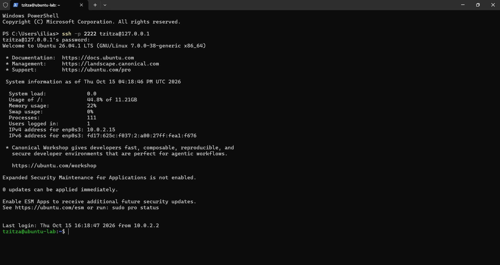
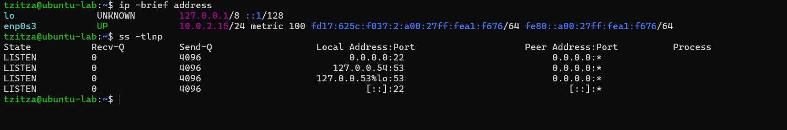

### Bash scripts

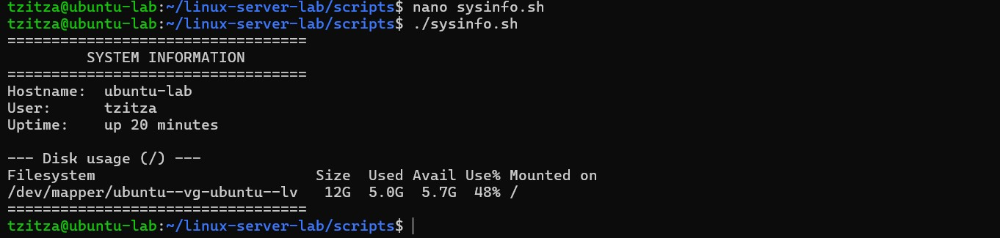
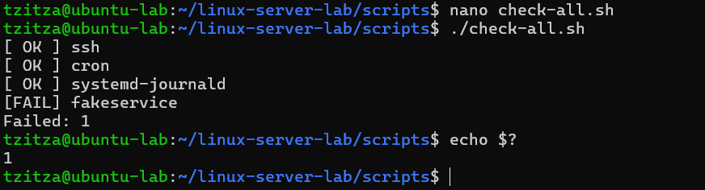
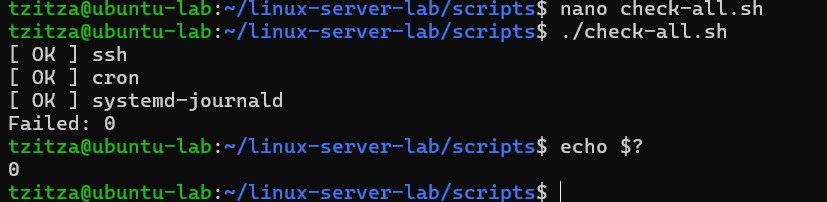
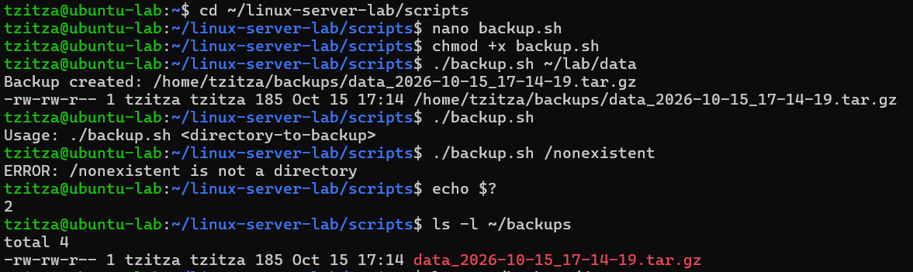
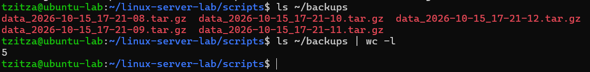

### Security hardening

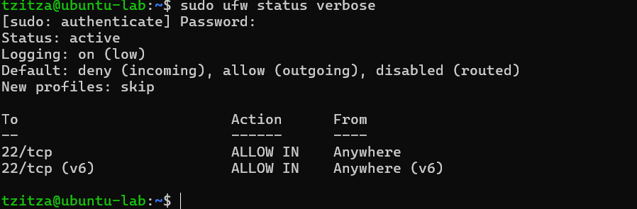
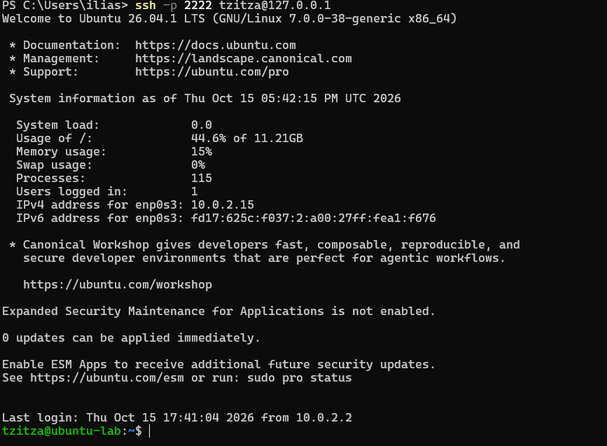
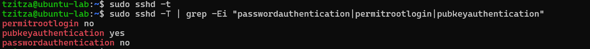
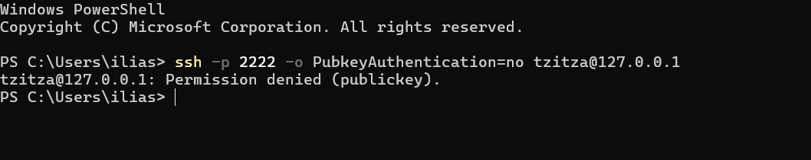
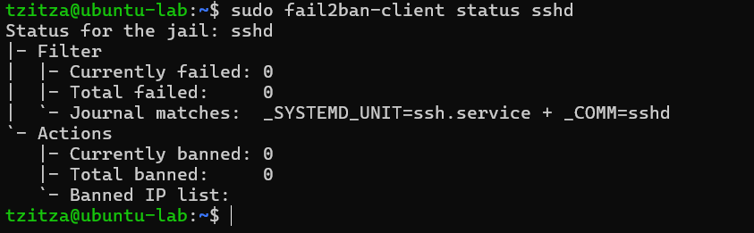

### Automation and reporting

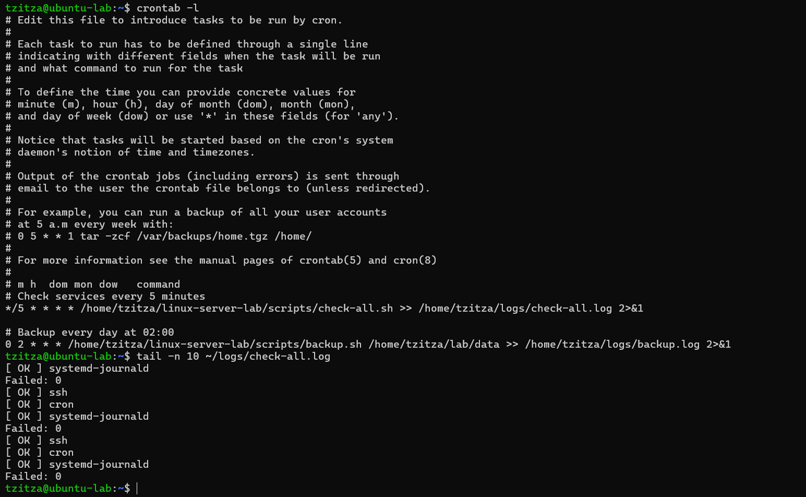
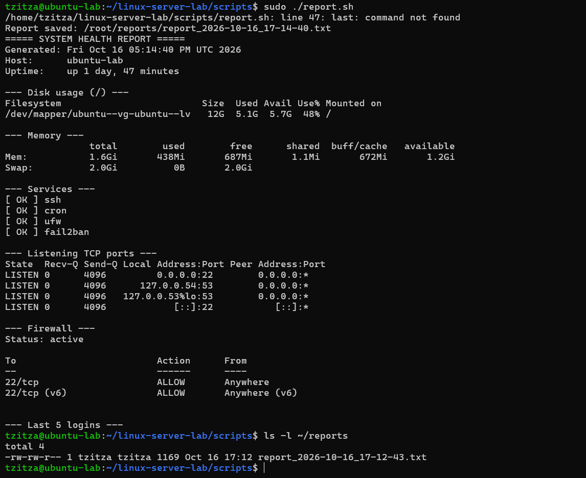

### Repository structure

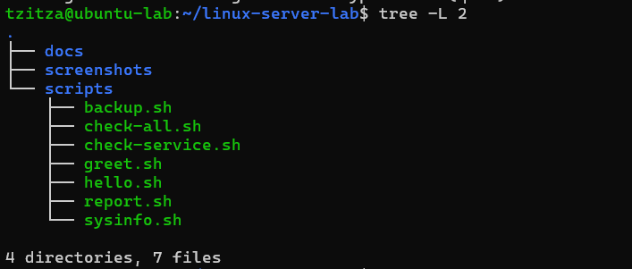

## What I learned

- How to install and configure Ubuntu Server in a VM, and how NAT port forwarding makes it reachable over SSH.
- Day-to-day administration: users, permissions, packages, services and logs.
- Diagnosing network problems step by step with `ip`, `ping` and `ss`.
- Hardening a server: default-deny firewall, key-only SSH, no root login, `fail2ban`.
- Writing Bash scripts with arguments, conditions, loops and meaningful exit codes.
- Automating tasks with `cron`, using full paths and redirecting output to log files.

## Notes

- Everything runs on a local VM for learning purposes.
- Backups require the VM to be running at 02:00.
